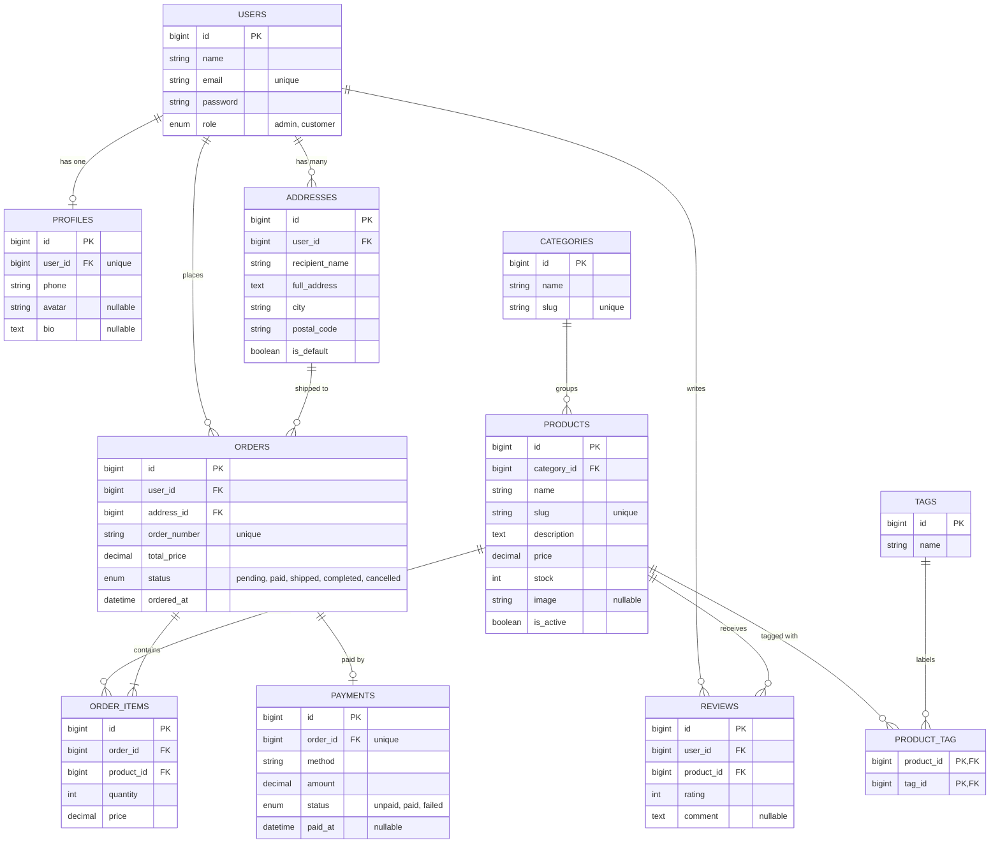

# Toko Online Mini — Aplikasi Toko Online Sederhana

Toko Online Mini adalah aplikasi web e-commerce sederhana yang dibangun dengan **Laravel**, **Blade**, dan **Tailwind CSS**. Project ini merupakan tugas semester dengan fokus pada perancangan dan implementasi **relasi antar tabel basis data** menggunakan Eloquent ORM.

## Fitur

- Katalog produk yang dikelompokkan berdasarkan kategori, dengan tag untuk penyaringan yang fleksibel
- Registrasi dan login pengguna dengan dua peran: `admin` dan `customer`
- Profil pengguna dan beberapa alamat pengiriman per pengguna
- Pemesanan: satu pesanan berisi satu atau lebih produk lengkap dengan jumlah dan harga
- Data pembayaran untuk setiap pesanan (metode, jumlah, status)
- Ulasan produk berupa rating dan komentar
- Stok berkurang otomatis ketika pesanan dibuat
- Hak akses berbasis peran: `admin` mengelola produk, kategori, dan pesanan; `customer` berbelanja dan memberi ulasan

## Desain Basis Data

Skema lengkap dan seluruh relasinya didokumentasikan dengan diagram Mermaid berikut.



### Relasi yang Dicakup

| Jenis                        | Contoh                                                                                                                                                   |
| ---------------------------- | -------------------------------------------------------------------------------------------------------------------------------------------------------- |
| One-to-One                   | `User` ↔ `Profile`, `Order` ↔ `Payment`                                                                                                                  |
| One-to-Many                  | `Category` → `Product`, `User` → `Order`, `User` → `Address`, `User` → `Review`, `Address` → `Order`, `Order` → `OrderItem`, `Product` → `Review`          |
| Many-to-Many                 | `Product` ↔ `Tag` (`product_tag`)                                                                                                                        |
| Many-to-Many dengan data pivot | `Order` ↔ `Product` melalui `order_items` (`quantity`, `price`)                                                                                        |
| Has-Many-Through             | `User` → `OrderItem` melalui `Order`                                                                                                                     |

### Aturan Bisnis

- `order_number` dan `slug` produk harus unik.
- Kolom `price` pada `order_items` adalah salinan harga produk saat pembelian, sehingga perubahan harga di kemudian hari tidak memengaruhi pesanan lama.
- `orders.total_price` adalah jumlah dari `quantity × price` seluruh item pesanan tersebut.
- Pesanan hanya dapat dibuat jika stok setiap produk mencukupi; stok dikurangi saat pesanan dibuat.
- Setiap pesanan memiliki paling banyak satu data pembayaran.
- Hanya customer yang pernah memesan suatu produk yang dapat mengulasnya.

## Teknologi

- PHP 8.3+ dan Laravel
- Template Blade
- Tailwind CSS (melalui Vite)
- MySQL atau SQLite

## Memulai

```bash
# Clone repository
git clone https://github.com/nrhyti/laravel5d
cd laravel5d

# Install dependensi
composer install
npm install

# Konfigurasi environment
cp .env.example .env
php artisan key:generate

# Buat skema tabel dan isi data contoh
php artisan migrate --seed

# Jalankan server pengembangan
npm run dev
php artisan serve
```

Lalu buka <http://localhost:8000>.

## Struktur Project

```
app/Models/        Model Eloquent dan relasinya
database/
  migrations/      Definisi tabel
  factories/       Pembuat data palsu
  seeders/         Kategori dan data contoh
resources/views/   Template Blade
```

## Roadmap

- [x] Perancangan dan dokumentasi basis data
- [ ] Migration, model, factory, dan seeder
- [ ] Autentikasi dan hak akses berbasis peran
- [ ] Pengelolaan produk dan kategori (CRUD)
- [ ] Keranjang, checkout, dan pesanan
- [ ] Pembayaran
- [ ] Ulasan

## Penulis

Nama Norhayati — NPM NPM 2410010025

## Lisensi

Dirilis di bawah [Lisensi MIT](https://opensource.org/licenses/MIT).