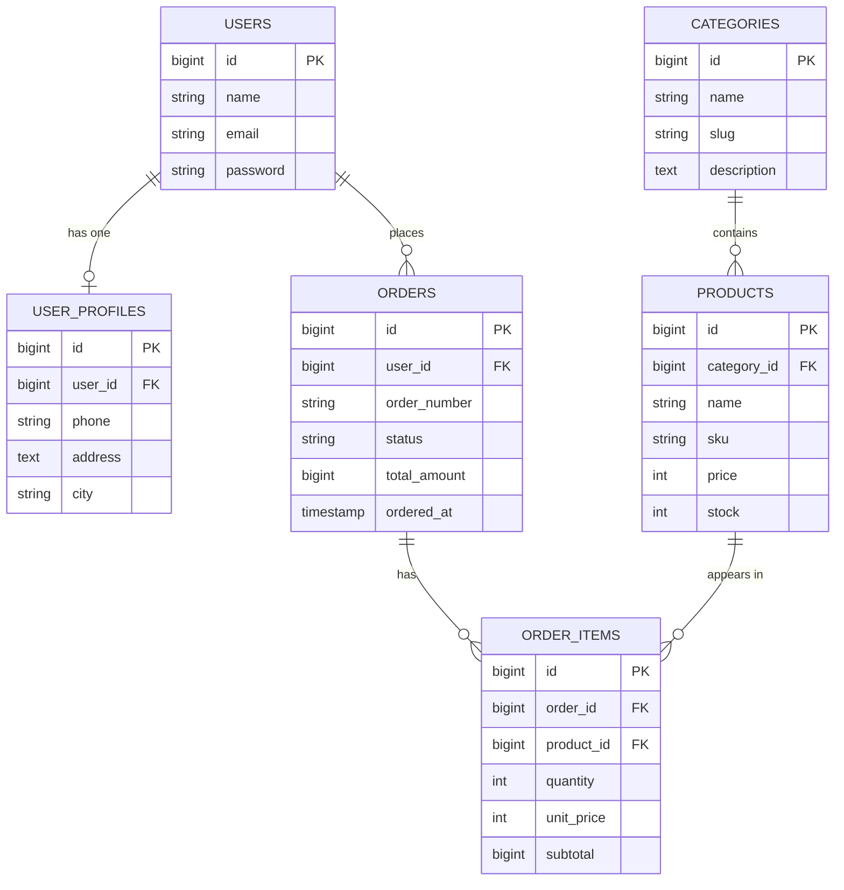
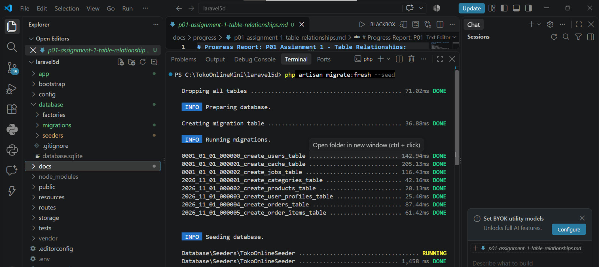
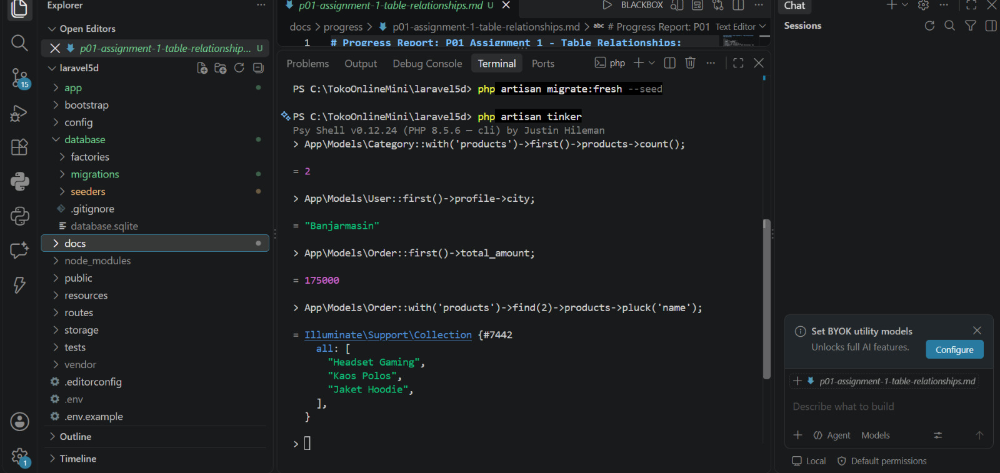

# Progress Report: P01 Assignment 1 - Table Relationships: Toko Online Mini

| | |
|---|---|
| **Student** | Norhayati |
| **NPM** | 2410010025 |
| **Class** | TI 5D REG BJB |
| **Phase** | P01: Database Design |
| **Assignment** | Assignment 1: Table Relationships: Toko Online Mini |
| **Date** | 1 November 2026 |
| **Branch** | `feature/p01-database-design` |

## 1. Tujuan

Merancang database untuk aplikasi Toko Online Mini dan mengimplementasikan tiga jenis relasi antar tabel di Laravel: one-to-one, one-to-many, dan many-to-many, lengkap dengan migration, model Eloquent, dan seeder.

## 2. Rancangan Tabel

| Tabel | Kolom utama | Keterangan |
|---|---|---|
| `users` | id, name, email, password | Bawaan Laravel (pembeli) |
| `user_profiles` | id, user_id (unique, FK), phone, address, city | Data tambahan user |
| `categories` | id, name (unique), slug (unique), description | Kategori produk |
| `products` | id, category_id (FK), name, sku (unique), description, price, stock | Produk yang dijual |
| `orders` | id, user_id (FK), order_number (unique), status, total_amount, ordered_at | Pesanan pembeli |
| `order_items` | id, order_id (FK), product_id (FK), quantity, unit_price, subtotal | Detail pesanan (tabel pivot) |

## 3. Diagram Relasi (ERD)



## 4. Ringkasan Relasi

| Relasi | Jenis | Implementasi |
|---|---|---|
| User - UserProfile | One-to-one | `User::profile()` (`hasOne`), `UserProfile::user()` (`belongsTo`), `user_id` dibuat `unique` |
| User - Order | One-to-many | `User::orders()` (`hasMany`), `Order::user()` (`belongsTo`) |
| Category - Product | One-to-many | `Category::products()` (`hasMany`), `Product::category()` (`belongsTo`) |
| Order - OrderItem | One-to-many | `Order::items()` (`hasMany`), `OrderItem::order()` (`belongsTo`) |
| Order - Product | Many-to-many | `Order::products()` dan `Product::orders()` (`belongsToMany`) lewat pivot `order_items` dengan `withPivot(quantity, unit_price, subtotal)` |

Aturan foreign key:
- `order_items.order_id` memakai `cascadeOnDelete` (hapus pesanan, itemnya ikut terhapus).
- `user_profiles.user_id` memakai `cascadeOnDelete`.
- `products.category_id`, `orders.user_id`, dan `order_items.product_id` memakai `restrictOnDelete` agar data yang masih dipakai tidak terhapus tanpa sengaja.
- `order_items` punya unique gabungan `(order_id, product_id)` supaya satu produk tidak muncul dua kali di pesanan yang sama.
- `unit_price` disimpan di `order_items` agar riwayat harga tetap benar walau harga produk berubah.

## 5. Daftar Pekerjaan

| Job | Deskripsi | File | Status |
|---|---|---|---|
| J1 | Merancang struktur tabel dan ERD | bagian 2 dan 3 laporan ini | Done |
| J2 | Membuat migration 5 tabel | `database/migrations/2026_11_01_00000*` | Done |
| J3 | Mendefinisikan foreign key dan constraint | migration `products`, `user_profiles`, `orders`, `order_items` | Done |
| J4 | Membuat model Eloquent dan relasinya | `app/Models/*` | Done |
| J5 | Membuat seeder data contoh | `database/seeders/TokoOnlineSeeder.php` | Done |
| J6 | Dokumentasi progress | file ini | Done |

## 6. Cara Menjalankan dan Verifikasi

```bash
git checkout feature/p01-database-design
composer install
cp .env.example .env
php artisan key:generate
# atur DB_* di .env (contoh: DB_CONNECTION=sqlite atau mysql), lalu:
php artisan migrate:fresh --seed
php artisan tinker
```

Perintah di tinker dan hasil yang diharapkan berdasarkan data seeder:

```php
App\Models\Category::with('products')->first()->products->count();
// 2  (Elektronik punya Mouse Wireless dan Headset Gaming)

App\Models\User::first()->profile->city;
// "Banjarmasin"

App\Models\Order::first()->items->count();
// 2

App\Models\Order::first()->total_amount;
// 175000  (1 x 85000 + 2 x 45000)

App\Models\Order::with('products')->find(2)->products->pluck('name');
// Kaos Polos, Jaket Hoodie, Headset Gaming

App\Models\Product::first()->orders->first()->pivot->quantity;
// 1
```

## 7. Bukti Hasil

Hasil `php artisan migrate:fresh --seed`:



Hasil pengecekan relasi di tinker:



## 8. Kendala dan Solusi

| Kendala | Solusi |
|---|---|
| Pivot `order_items` punya kolom tambahan | Memakai `withPivot()` dan `withTimestamps()` pada relasi `belongsToMany` |
| Harga produk bisa berubah | Menyimpan `unit_price` di `order_items` sebagai harga saat transaksi |

## 9. Belum Dikerjakan

- Controller, route, dan tampilan (di luar scope Assignment 1).
- Validasi input dan autentikasi.
- Factory dan automated test.
